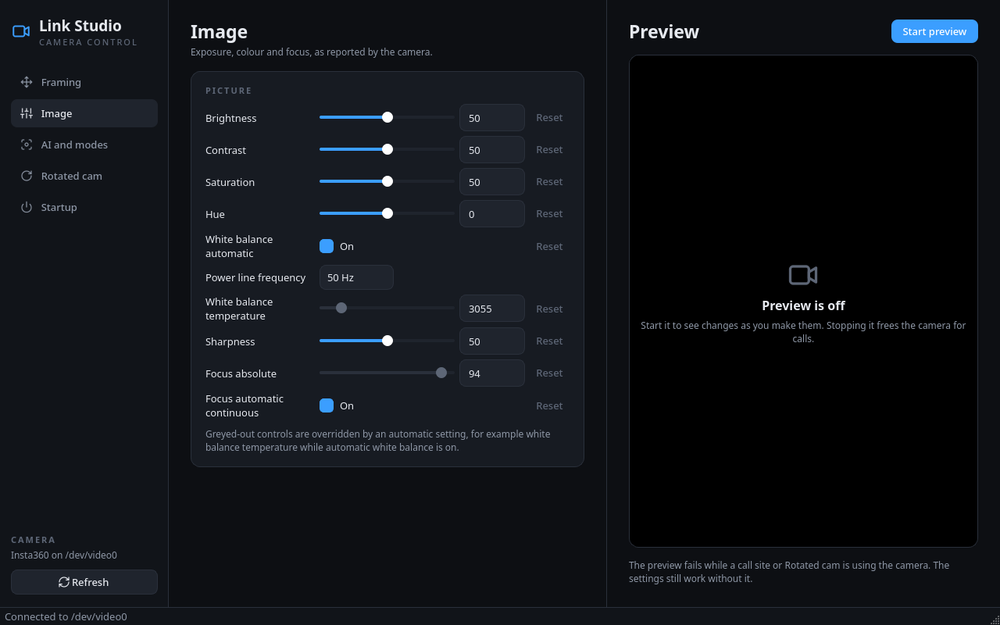

# Link Studio

A Linux control panel for the Insta360 Link 2 webcam.



Insta360's own Link Controller only runs on Windows and macOS. On Linux the
camera works as a normal webcam, but its framing, AI tracking and startup
behaviour can only be changed with hand gestures. Link Studio gives those
settings a desktop interface, and restores your preferred setup every time
the camera connects, because the camera itself forgets them on power loss.

## Features

| Tab | What it does |
| --- | --- |
| Framing | Pan, tilt and zoom sliders, a 5° nudge pad, a centre button, and six position presets stored in the camera. |
| Image | Every standard control the camera reports: brightness, contrast, white balance, focus and so on. Built from the camera at runtime, so new firmware controls appear automatically. |
| AI and modes | AI tracking on or off, tracking framing (head, half body, full body), and the Normal, DeskView, Whiteboard and Overhead modes. |
| Preview | A live picture. Opens the camera only while switched on. |
| Rotated cam | Starts and stops the `cam-rotate` virtual camera, for a camera turned on its side. Shown only when `cam-rotate` is installed. |
| Startup | Saves your settings and re-applies them whenever the camera connects. |

## Platform support

Link Studio runs on **Linux only**. It is written in Python with Qt, which
both run on Windows and macOS, but every part that talks to the camera uses
Linux interfaces:

| Part | Linux interface it depends on |
| --- | --- |
| Standard controls | `v4l2-ctl` and Video4Linux, the Linux kernel's camera API |
| Finding the camera | `/sys/class/video4linux` (sysfs) |
| Tracking, modes and presets | `linkctl`, which issues Linux UVC ioctls |
| Automatic apply | a systemd user service |
| Rotated cam | the `v4l2loopback` kernel module |

**On Windows or macOS**, use Insta360's own Link Controller, available
from the [Insta360 Download Center](https://www.insta360.com/download). It
covers everything Link Studio does and more. Link Studio exists because
that application has no Linux version.

WSL is not a workaround: it has no normal access to USB webcams, and it
still would not provide systemd device units for camera connections.

A Windows port is possible without touching most of the code, because the
interface, services and domain only depend on the protocols in `ports.py`.
It would need Windows implementations of `ControlBackend` (DirectShow's
`IAMCameraControl` and `IAMVideoProcAmp`), the tracking and gimbal
backends (the camera's extension unit through Kernel Streaming), a
`CameraLocator`, and an `Autostart` built on Task Scheduler, all selected
in `wiring.py`.

## Requirements

- Linux with systemd
- Python 3.12 or newer
- `pyside6` 6.11 or newer (Qt 6, including Qt Multimedia)
- `v4l-utils`, which provides `v4l2-ctl`
- `linkctl`, from
  [Insta360 Link 1 and 2 Controller for Linux](https://github.com/vrwallace/Insta360-Link-1-and-2-Controller-for-Linux),
  on your `PATH`
- Optional: `cam-rotate`, for the Rotated cam tab

On Arch Linux:

```bash
sudo pacman -S pyside6 v4l-utils python-pipx fpc
```

Build `linkctl` from its source. Read the source first: it sends raw
commands to a USB device. The repository ships a precompiled `.ppu` file,
which is deleted here so everything is compiled from readable source.

```bash
git clone https://github.com/vrwallace/Insta360-Link-1-and-2-Controller-for-Linux insta360-linkctl
cd insta360-linkctl
rm -f ./*.ppu
mkdir -p build
fpc -O2 -FUbuild -obuild/linkctl linkctl.pas
install -Dm755 build/linkctl ~/.local/bin/linkctl
```

`linkctl` also ships a udev rule that makes the camera writable by every
user. It is not needed if you are in the `video` group, which is the Arch
default for desktop users (`groups | grep video` to check).

## Installation

### From a release

Download the wheel (`link_studio-<version>-py3-none-any.whl`) from the
[releases page](https://github.com/VTech-Studios/link-studio/releases), then:

```bash
pipx install --system-site-packages link_studio-1.0.0-py3-none-any.whl
```

`--system-site-packages` reuses the distribution's PySide6, which is large
and already installed. To upgrade later, install the newer wheel with
`pipx install --force`.

### From source

Clone the repository and install it in editable mode:

```bash
git clone https://github.com/VTech-Studios/link-studio.git
cd link-studio
pipx install --system-site-packages --editable .
```

`--editable` makes the installed command run the cloned folder, so changes
take effect without reinstalling.

### Making `link-studio` a command

`pipx` gives the application its own isolated environment and puts a
`link-studio` launcher in `~/.local/bin`. To run it by name from any
directory, like any other program, that folder must be on your `PATH`.

When you type a bare command, the shell does not look in the current
directory. It searches only the directories listed in `PATH`, in order, and
runs the first match. `~/.local/bin` is the standard place for programs
installed for your user alone: it needs no root access.

Check whether it is already there:

```bash
echo "$PATH" | tr ':' '\n' | grep -x "$HOME/.local/bin"
```

If that prints the directory, nothing more is needed. If it prints nothing,
let `pipx` add it to your shell's startup file:

```bash
pipx ensurepath
```

Then open a new terminal, because a running shell only reads its startup
file when it starts. Confirm the shell finds the command:

```bash
command -v link-studio
```

```
/home/<you>/.local/bin/link-studio
```

If a terminal that was already open still cannot find it, run `hash -r`.
`bash` caches the location of each command it has looked up, and that
cache predates the new launcher.

Without `pipx`, you can run the application straight from the source
folder, but only from inside it:

```bash
python -m link_studio
```

### Running it

Run `link-studio` from a terminal, or find **Link Studio** in the
application menu. To add the menu entry:

```bash
install -Dm644 /dev/stdin ~/.local/share/applications/link-studio.desktop <<'EOF'
[Desktop Entry]
Type=Application
Name=Link Studio
Comment=Control panel for the Insta360 Link 2 webcam
Exec=link-studio
Icon=camera-web
Categories=AudioVideo;Video;
EOF
```

## Usage

### Keeping your settings across reboots

The camera powers up with AI tracking on and every other setting at its
default. To restore your own setup automatically:

1. Set the camera up on the Framing, Image and AI tabs.
2. On the Startup tab, choose whether tracking should be on, and which mode
   to use when it is off.
3. Click **Save current settings**.
4. Tick **Apply automatically whenever the camera connects**.

The settings are stored in `~/.config/link-studio/startup.json` and applied
at login and every time the camera is plugged in. To check it worked,
unplug the camera, plug it back in, and run:

```bash
journalctl --user -u link-studio-apply.service -n 5
```

You can also apply the saved settings by hand:

```bash
link-studio --apply
```

### Using the camera in a call at the same time

Changing a setting never needs exclusive access, so every control works
while a browser or video call is using the camera. Only the Preview tab
needs the camera to itself, and it reports an error if something else has
it.

### Using a different camera

The camera is found by name. To point Link Studio at another UVC camera,
set part of its name:

```bash
LINK_STUDIO_CAMERA="Obsbot" link-studio
```

Standard controls work with any UVC camera. The AI and modes tab, presets
and centring use `linkctl`, which only supports the Insta360 Link and Link 2.

## How automatic apply works

The service needs no root access and no udev rule. The camera contains a
microphone, and systemd creates a device unit for every sound card. The
user service `~/.config/systemd/user/link-studio-apply.service` is
`WantedBy` that device unit, so your own session starts it whenever the
camera appears. The camera's video node is not tagged for systemd, which is
why its sound card is used as the trigger.

When it runs, `link-studio --apply`:

1. Waits up to 15 seconds for the video node, which can appear after the
   sound card.
2. Waits 2 seconds more. The firmware keeps initialising briefly after the
   node appears and overwrites anything sent earlier with its defaults.
3. Applies tracking or the mode first, because tracking overrides pan and
   tilt. Tracking and the modes share one setting in the camera, so only
   one of them is written.
4. Applies automatic switches, such as automatic white balance, before the
   values they govern, because the camera refuses a manual value while the
   automatic mode is still on.

The headless path never imports Qt, so it starts quickly and can run before
a desktop session exists.

## Architecture

The code is split into layers. Each layer depends only on the ones above it
in this table, and on interfaces rather than concrete classes.

| Layer | Location | Responsibility |
| --- | --- | --- |
| Domain | `domain.py` | Controls, profiles and the rules about them. No I/O, no Qt. |
| Ports | `ports.py` | Protocols for everything outside the application: running commands, reading controls, vendor features, storage, autostart, rotation. |
| Services | `services/` | Use cases: saving and applying a startup profile, and the wait-and-apply logic run on connect. |
| Infrastructure | `infrastructure/` | Adapters that implement the ports with `v4l2-ctl`, `linkctl`, sysfs, systemd, JSON files and `cam-rotate`. |
| Interface | `ui/` | Qt widgets. One class per tab, one editor class per control type, and a shared model that every view listens to. |
| Composition | `wiring.py`, `app.py`, `config.py` | The only place concrete classes are chosen and connected. |

Some design decisions:

- **Dependency injection throughout.** Every class receives its
  collaborators through its constructor. Tests pass in fakes instead of
  patching modules.
- **Interface segregation.** Vendor features are split into
  `TrackingBackend` and `GimbalBackend`, so the AI tab cannot move the
  gimbal and the Framing tab cannot change modes. One adapter,
  `LinkctlBackend`, implements both.
- **One source of truth for control values.** `ControlsModel` reads the
  camera and emits `updated`. Every panel listens to it, so a change made
  anywhere (a slider, a preset, applying a profile) appears everywhere
  after one read, and the tabs never refer to each other.
- **Open for extension.** Adding a control type means adding one editor
  class and one entry in `EDITORS`. Adding a camera backend means
  implementing the ports and changing `wiring.py`.
- **Errors are values the user can read.** Every failure becomes a
  `CameraError` with a plain-language message, and every action runs
  through `StatusFeedback`, which shows it in the status bar instead of
  letting it escape into Qt's event loop.

## Development

Create a virtual environment that can see the system PySide6, and install
the development tools into it:

```bash
python -m venv --system-site-packages .venv
.venv/bin/pip install -e '.[dev]'
```

Run the checks:

```bash
.venv/bin/ruff check link_studio tests scripts
.venv/bin/ruff format --check link_studio tests scripts
.venv/bin/mypy
.venv/bin/pytest --cov
```

Check the development dependencies for known vulnerabilities:

```bash
.venv/bin/pip-audit --local
```

`--local` limits the audit to packages installed in `.venv`. PySide6 comes
from the distribution, so it is kept current by the system package manager
(`pacman -Syu` on Arch) and can be audited on its own with
`pip-audit -r <(echo "PySide6==$(python -c 'import PySide6; print(PySide6.__version__)')")`.

The tests need no camera and no display. Widget tests run on Qt's
offscreen platform, and every external tool is replaced by an in-memory
fake from `tests/fakes.py`. One test builds the real window end to end
against a fake camera.

Code conventions:

- `ruff` with a broad rule set, and `mypy --strict` on both the package and
  the tests.
- Comments are docstrings only. A docstring starts with a one-line summary
  in the imperative mood, then explains why the code is the way it is when
  that is not obvious. There are no inline comments.

## Continuous integration

Two GitHub Actions workflows live in `.github/workflows`:

- `ci.yml` runs the lint, type, test and audit checks on every push to
  `master` and on every pull request.
- `release.yml` runs when a version tag is pushed. It runs the same checks,
  confirms the tag matches the package version, builds the wheel and source
  distribution, and publishes a GitHub release with that version's notes
  from `CHANGELOG.md` and both files attached.

## Releasing

A release is a git tag plus a GitHub release page with downloadable files.
The release workflow does the building and publishing; a release only
needs the version, the changelog and a tag.

1. Choose the new version using [Semantic Versioning](https://semver.org/):
   bump the patch number (`1.0.1`) for fixes, the minor number (`1.1.0`) for
   new features, and the major number (`2.0.0`) for changes that break how
   people use it.
2. Set `__version__` in `link_studio/__init__.py`. It is the only place the
   version is written; `pyproject.toml` reads it from there.
3. In `CHANGELOG.md`, move the entries under `[Unreleased]` into a new
   `## [x.y.z] - YYYY-MM-DD` section and update the links at the bottom.
4. Check that the release is consistent, then commit:

   ```bash
   .venv/bin/python scripts/release_notes.py --check-tag vX.Y.Z
   .venv/bin/python scripts/release_notes.py vX.Y.Z
   git commit -am "Release X.Y.Z"
   ```

5. Tag the commit and push both:

   ```bash
   git tag -a vX.Y.Z -m "Link Studio X.Y.Z"
   git push origin master vX.Y.Z
   ```

The workflow then publishes the release. If the tag and version disagree,
or the changelog has no section for the version, it stops before anything
is published.

To build the files locally without releasing:

```bash
.venv/bin/python -m build
```

The wheel and source distribution appear in `dist/`.

## Limitations

- The Preview tab's start path is not covered by tests, because it needs a
  physical camera. Everything else has line and branch coverage.
- `linkctl` always exits with status 0. Link Studio treats a command as
  failed unless `linkctl` prints `OK`, which is how `linkctl` reports
  success.
- The camera cannot report its tracking or mode state back, so the AI tab
  uses buttons rather than toggles.
- Hand gestures are handled inside the camera's firmware and cannot be
  disabled from Linux.

## Licence

MIT.
